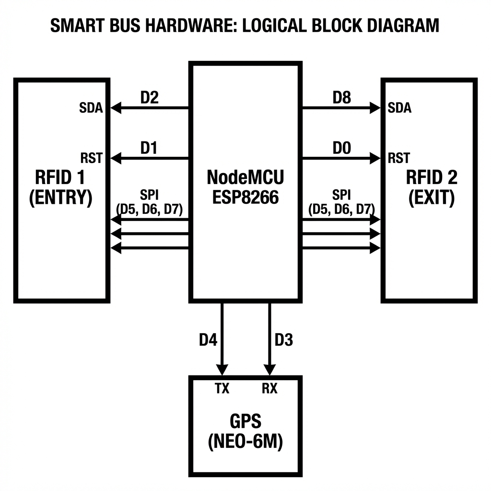

# Smart Bus Hardware Setup Guide

Use this guide for connecting your components. This table is the **single source of truth** for your wiring.

## 📌 Pin Mapping Table

| Component | Pin Label | Connected to NodeMCU Pin | Note |
|-----------|-----------|--------------------------|------|
| **RFID 1 (ENTRY)** | SDA (SS) | **D2** (GPIO 4) | Chip Select for Entry |
| | RST | **D1** (GPIO 5) | Reset for Entry |
| | SCK | **D5** (GPIO 14) | Shared SPI Clock |
| | MOSI | **D7** (GPIO 13) | Shared SPI MOSI |
| | MISO | **D6** (GPIO 12) | Shared SPI MISO |
| | GND | **GND** | Black Wire |
| | 3.3V | **3.3V** | Red Wire |
| | | | |
| **RFID 2 (EXIT)** | SDA (SS) | **D8** (GPIO 15) | Chip Select for Exit |
| | RST | **D0** (GPIO 16) | Reset for Exit |
| | SCK | **D5** (GPIO 14) | Shared SPI Clock |
| | MOSI | **D7** (GPIO 13) | Shared SPI MOSI |
| | MISO | **D6** (GPIO 12) | Shared SPI MISO |
| | GND | **GND** | Shared with others |
| | 3.3V | **3.3V** | Shared with others |
| | | | |
| **GPS (NEO-6M)** | TX | **D4** (GPIO 2) | SoftwareSerial RX on Board |
| | RX | **D3** (GPIO 0) | SoftwareSerial TX on Board |
| | VCC | **3.3V** or **5V** | Check your GPS module limits! |
| | GND | **GND** | Shared Ground |

> **⚠️ Important:** 
> - **SPI Lines (SCK, MOSI, MISO)** are SHARED. You must connect wires from D5, D7, and D6 to BOTH RFID readers.
> - **Power:** Ensure your power source can handle 2 RFIDs and 1 GPS. A breadboard power supply module is recommended if USB power is insufficient.
