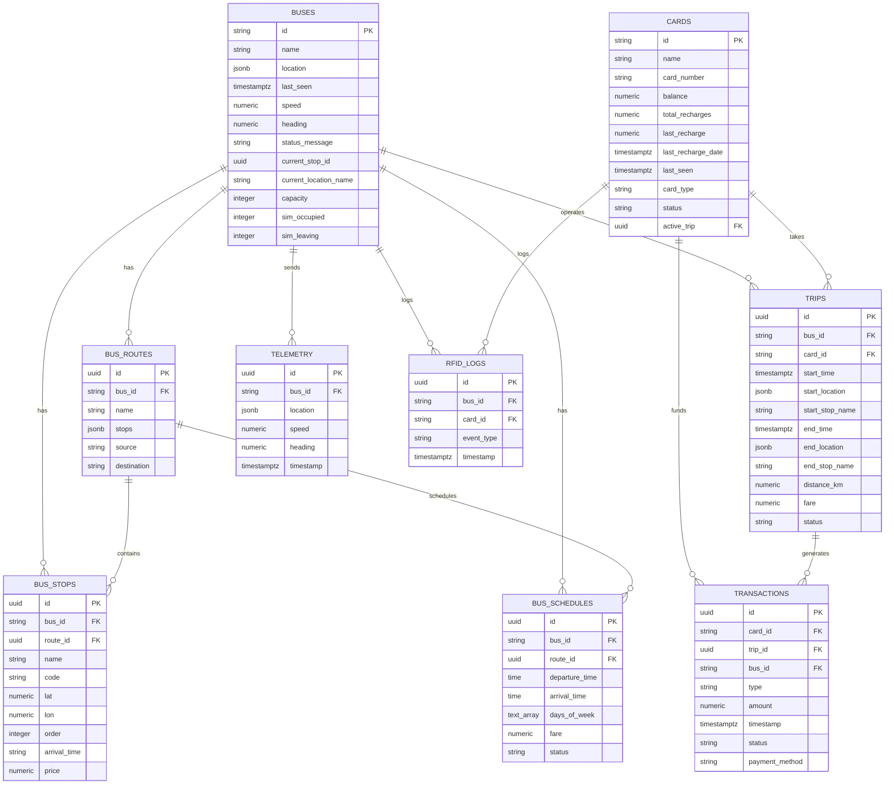

# 🚍 Smart Bus System

**Author:** Shashank Bhat (@shashank-bhat10)

A state-of-the-art, end-to-end IoT-enabled **Smart Bus Tracking and Passenger Management System**. The platform leverages real-time GPS tracking, RFID-based boarding/alighting detection, distance-based fare calculation, predictive analytics for passenger occupancy, and a modern fleet management dashboard.

---

## 🧭 System Architecture & Flow

The system consists of five main components interacting in real time:

```
                               +-----------------------------+
                               |    ESP8266 IoT Hardware     |
                               | (NEO-6M GPS & Dual RC522)   |
                               +--------------+--------------+
                                              |
                                              | HTTPS REST API (RPC / Express)
                                              v
                               +--------------+--------------+
                               |      Supabase Backend       |
                               |  - PostgreSQL Database      |
                               |  - Real-time Subscriptions  |
                               |  - PL/pgSQL RPC Functions   |
                               +-------+--------------+------+
                                       |              |
                Real-time subscriptions|              | REST API / JSON
                                       v              v
       +-------------------------------+--+        +--+---------------------------+
       |   React Admin Web Dashboard      |        |     React Native Expo App     |
       |  - Live fleet tracking on map    |        |  - Passenger live bus map    |
       |  - Route/schedule management     |        |  - Visual seat occupancy     |
       |  - Bus visual seat occupancy map |        |  - Balance & top-up wallet   |
       |  - Flask ML prediction panel     |        |  - Gemini AI route chatbot   |
       +----------------------------------+        +------------------------------+
                               ^
                               | Predictions API
                               v
               +---------------+---------------+
               |    Flask ML Predictor API     |
               |  - scikit-learn Random Forest |
               |  - Boarding/alighting forecasts|
               +-------------------------------+
```

### Core Communication Flows
1. **Telemetry Upload**: The NodeMCU ESP8266 on the bus fetches GPS coordinates from the NEO-6M sensor every 10 seconds and invokes the `handle_telemetry` RPC endpoint.
2. **Passenger Boarding**: Passengers tap their RFID card on the **Entry MFRC522 Scanner**. The hardware validates the card, verifies a minimum balance of ₹50, opens an active trip, and increments the bus passenger count in Supabase.
3. **Passenger Alighting**: Passengers tap on the **Exit MFRC522 Scanner** when leaving. The system computes the fare, deducts it from the card balance, terminates the active trip, logs the transaction, and decrements the passenger count.
4. **Live Visualization**: The React Admin Web and React Native Expo Apps subscribe to Supabase tables using WebSockets. When telemetry or occupancy changes, the UI updates instantly without polling.
5. **Demand Forecasting**: The Admin panel queries the Flask Python ML service to predict passenger boarding and alighting at each upcoming stop using Random Forest Regressors.

---

## 🛠️ Database Schema

The PostgreSQL database schema is defined in `schema.sql` and includes the following primary tables, indexes, and relations:



### Performance Optimization Indexes
To ensure fast queries during high concurrent hardware updates, the following indexes are deployed:
- `idx_bus_schedules_bus_id` & `idx_bus_schedules_route_id`: Accelerates stop and route schedules search.
- `idx_cards_card_number`: Speeds up physical RFID card authorization matches.
- `idx_telemetry_bus_id` & `idx_telemetry_timestamp`: Optimizes location history queries for mapping.
- `idx_rfid_logs_card_id` & `idx_rfid_logs_timestamp`: Quick retrieval of boarding logs for user history screens.

---

## ⚡ Algorithms & APIs

The project implements specialized algorithms across the database layer, the Express middle tier, and the Python ML service.

### 1. Database-Level Control Logic (PL/pgSQL RPCs)
To keep the embedded client logic light and secure, all logical checks run inside Supabase via Remote Procedure Call (RPC) functions:

*   **`handle_bus_entry(p_card_uid, p_bus_id, p_lat, p_lon)`**
    *   **Validation**: Searches the `cards` table by UUID or custom card number. Returns an error if the card is not registered.
    *   **Financial Control**: Rejects the card if the current balance is `< ₹50` (ensuring sufficient balance for the fare deduction at exit).
    *   **State Control**: Checks if `active_trip` is not null to prevent double entry scans.
    *   **Resolution**: Invokes `resolve_stop_name` to record the station name.
    *   **Telemetry Sync**: Creates a new row in `trips` (`ongoing`), updates the card's `active_trip`, adds to `rfid_logs`, and increments the bus's `sim_occupied` counter (capped at bus capacity).

*   **`handle_bus_exit(p_card_uid, p_bus_id, p_lat, p_lon)`**
    *   **Validation**: Fetches the card and verifies that an `active_trip` exists.
    *   **Fare Collection**: Charges a base flat fare of ₹50 (configurable or matching Express dynamic algorithm).
    *   **State Resolution**: Sets the card's `active_trip` back to `NULL`, updates `trips` status to `completed`, records the `end_time`, `end_location`, and `end_stop_name`.
    *   **Accounting**: Inserts a transaction record of type `trip` and logs to `rfid_logs`.
    *   **Telemetry Sync**: Decrements the bus's `sim_occupied` counter (bounded at a minimum of 0).

*   **`handle_telemetry(p_bus_id, p_lat, p_lon, p_speed)`**
    *   Logs incoming coordinate samples into the historical `telemetry` table.
    *   Updates the live location, heading, and current speed in the `buses` record.

### 2. Express Backend Middleware Algorithms (`functions/index.js`)
An Express API is also available to act as a custom device middleware, containing two critical algorithms:

#### A. Geolocation Stop Resolution (Haversine Formula)
When GPS telemetry is received, the backend compares coordinates with the route's predefined bus stops to determine the current stop name using the **Haversine formula** (distance over a sphere):

$$\text{distance} = 2 R \arcsin\left(\sqrt{\sin^2\left(\frac{\Delta \text{lat}}{2}\right) + \cos(\text{lat}_1) \cos(\text{lat}_2) \sin^2\left(\frac{\Delta \text{lon}}{2}\right)}\right)$$

```javascript
function haversineKm(lat1, lon1, lat2, lon2) {
  const toRad = (v) => (v * Math.PI) / 180;
  const R = 6371; // Earth's radius in kilometers
  const dLat = toRad(lat2 - lat1);
  const dLon = toRad(lon2 - lon1);
  const a = Math.sin(dLat / 2) * Math.sin(dLat / 2) +
    Math.cos(toRad(lat1)) * Math.cos(toRad(lat2)) *
    Math.sin(dLon / 2) * Math.sin(dLon / 2);
  const c = 2 * Math.atan2(Math.sqrt(a), Math.sqrt(1 - a));
  return R * c;
}
```
*If the calculated distance is less than 0.5 km (500 meters) from a stop coordinate, the bus is officially recognized as arriving at that stop.*

#### B. Dynamic Route-Stop Price Fare Calculation
During the exit event `/device/rfid`, the API performs a dynamic progressive calculation. It locates the entry stop and exit stop indices within the route's stop list and sums up the custom price segments between them:

```javascript
let fare = 10; // Default base fare fallback
if (ctx?.stopsList?.length > 0) {
  const sIdx = ctx.stopsList.findIndex(s => s.name === trips.start_stop_name);
  const eIdx = ctx.stopsList.findIndex(s => s.name === stopName);
  if (sIdx !== -1 && eIdx !== -1) {
    fare = 0;
    // Handle both directions (forward and reverse indexing)
    const [low, high] = sIdx < eIdx ? [sIdx, eIdx] : [eIdx, sIdx];
    for (let i = low; i <= high; i++) {
      fare += (Number(ctx.stopsList[i].price) || 10);
    }
  }
}
```

### 3. Machine Learning Forecasting Algorithm (`ml_prediction`)
The ML service operates on a **Random Forest Regressor** ensemble model implemented in Python using `scikit-learn` to forecast boarding and alighting.

#### Features Used in Forecasting:
- `stop_id`: The ID of the station (spatial identifier).
- `hour`: Hour of the day (0-23) (temporal cycle).
- `day_of_week`: Day of week (0-6) (distinguishes weekdays from weekends).
- `is_peak_hour`: Binary flag (1 for morning peak 7-9 AM, evening peak 5-7 PM; 0 otherwise).
- `current_occupancy`: Live passenger count on the bus.
- `stop_sequence`: Normalized stop order (0.0 to 1.0) along the route.
- `historical_avg`: Rolling average passenger activity for the stop.

#### Training Pipeline:
- Generates 180 days of hourly stop activity data with realistic peaks using a Normal distribution.
- Trains two separate Random Forest Regressors (200 decision trees, max depth of 15) for:
  1. **Boarding Predictor**: Estimates how many passengers will enter at the stop.
  2. **Alighting Predictor**: Estimates how many passengers will exit.
- Evaluates the model using MAE (Mean Absolute Error), RMSE (Root Mean Squared Error), and R² scores.
- Exposes predictions via a Flask REST API.

---

## 🎛️ Hardware & Control Methods

The smart bus hardware uses a NodeMCU ESP8266 board acting as a main controller. It interfaces with two MFRC522 RFID readers (separating entry and exit gates) and a NEO-6M GPS module.

### 📌 Pin Mapping Table

| Component | Pin Label | Connected to NodeMCU Pin | Function / Note |
|:---|:---|:---|:---|
| **RFID 1 (ENTRY)** | SDA (SS) | **D2** (GPIO 4) | Chip Select (Active Low) for Boarding Reader |
| | RST | **D1** (GPIO 5) | Reset pin for Entry Reader |
| | SCK | **D5** (GPIO 14) | SPI Shared Clock Line |
| | MOSI | **D7** (GPIO 13) | SPI Shared Master Out Slave In |
| | MISO | **D6** (GPIO 12) | SPI Shared Master In Slave Out |
| | GND | **GND** | Ground Connection |
| | 3.3V | **3.3V** | Power (Max 3.3V - Do not connect to 5V!) |
| | | | |
| **RFID 2 (EXIT)** | SDA (SS) | **D8** (GPIO 15) | Chip Select (Active Low) for Alighting Reader |
| | RST | **D0** (GPIO 16) | Reset pin for Exit Reader |
| | SCK | **D5** (GPIO 14) | SPI Shared Clock Line |
| | MOSI | **D7** (GPIO 13) | SPI Shared Master Out |
| | MISO | **D6** (GPIO 12) | SPI Shared Master In |
| | GND | **GND** | Ground Connection |
| | 3.3V | **3.3V** | Shared 3.3V Power Line |
| | | | |
| **GPS (NEO-6M)** | TX | **D4** (GPIO 2) | NodeMCU Software Serial RX |
| | RX | **D3** (GPIO 0) | NodeMCU Software Serial TX |
| | VCC | **3.3V / 5V** | VCC Power Input |
| | GND | **GND** | Shared Ground |

### 🔄 Firmware Control Loop & Logic

The firmware folder contains two alternative versions depending on your hardware assembly:
1. **Single RFID Reader with GPS** (`smart_bus_single_rfid_gps`): Best for single reader setups where the system automatically toggles entry/exit based on the active trip status.
2. **Dual RFID Reader without GPS** (`smart_bus_dual_rfid_no_gps`): Best for setups with distinct Entry and Exit gates, utilizing two MFRC522 readers.

Key control loop features include:
- **SPI Bus Multiplexing**: Because both RFID reader modules share the SPI lines (`D5`, `D6`, `D7`), the NodeMCU selects which reader it is communicating with by pulling its corresponding Slave Select pin (`D2` or `D8`) low.
- **GPS Frame Parsing**: The firmware continuously reads incoming serial bytes from the GPS module in `loop()` and pipes them to the `TinyGPSPlus` parser. Valid location fixes update internal latitude/longitude coordinates.
- **5-Second Software Tap Debouncing**: To prevent passengers from triggering double charges if their card lingers near the RF field, the system implements a software timer:
  ```cpp
  if (uid == lastUidEntry && (millis() - lastTimeEntry < 5000)) {
      Serial.println("Ignored Duplicate Entry Tap: " + uid);
      return;
  }
  ```
- **Asynchronous Telemetry Upload**: Telemetry data is sent to the server every 10 seconds via a non-blocking `millis()` delta check.
- **HTTPS Client Security**: The board uses `WiFiClientSecure` with `.setInsecure()` mode to skip SSL fingerprint validation, making it light enough to run on a cheap ESP8266 chip without certificate management.

---

## 📂 Project Structure Tree

```
smart-bus-supabase/
├── admin-web/                      # React Fleet Management Dashboard (Vite)
│   ├── dist/                       # Production build directory
│   ├── public/                     # Static assets (images, icons, custom diagrams)
│   ├── src/
│   │   ├── components/             # Reusable UI dashboard elements
│   │   │   ├── ThemeToggle.jsx     # Dark/Light mode theme button
│   │   │   ├── ConnectionStatus.jsx# Database synchronization status indicator
│   │   │   ├── LogsViewer.jsx      # Streaming logs table
│   │   │   ├── Sidebar.jsx         # Sidebar navigation component
│   │   │   ├── MLPredictionPanel.jsx# Connects to Flask to render stop prediction charts
│   │   │   ├── TimePicker.jsx      # Time picker element for schedules
│   │   │   ├── BusSeatMap.jsx      # Interactive seat grid mapping capacity occupancy
│   │   │   ├── RouteTimeline.jsx   # Live visual representation of bus stops
│   │   │   ├── PassengerFrequencyChart.jsx # Hourly passenger frequency chart
│   │   │   └── RoutePassengerChart.jsx     # Route-by-route boarding/alighting stats
│   │   ├── context/
│   │   │   └── ThemeContext.jsx    # React Context Provider for app theme state
│   │   ├── pages/                  # Main Dashboard Views
│   │   │   ├── Dashboard.jsx       # Global fleet status overview page
│   │   │   ├── BusesPage.jsx       # Add, modify, or update bus capacities
│   │   │   ├── RoutesPage.jsx      # Map out stops and create routes
│   │   │   ├── SchedulesPage.jsx   # Dispatch schedules for buses
│   │   │   └── StatusPage.jsx      # Raw telemetry tracking details page
│   │   ├── utils/
│   │   │   ├── supabaseTest.js     # DB connectivity utility
│   │   │   └── simulatedData.js    # Local backup generators for testing
│   │   ├── App.jsx                 # Client entrypoint and route definitions
│   │   ├── main.jsx                # DOM mounting
│   │   └── styles.css              # Custom styling tokens (vanilla CSS & layouts)
│   ├── package.json
│   └── vite.config.js
│
├── expo-user-app/                  # React Native Mobile App for Passengers
│   └── user-app/
│       ├── assets/                 # App assets (icons, splash screens, seat maps)
│       ├── components/             # Custom mobile view components
│       ├── screens/                # Mobile application views
│       │   ├── WelcomeScreen.js    # Welcome splash page
│       │   ├── LoginScreen.js      # User registration / account sign-in
│       │   ├── HomeScreen.js       # Main routing hub and quick links
│       │   ├── FindBusScreen.js    # Search routes and upcoming buses
│       │   ├── BusListScreen.js    # Displays list of active buses
│       │   ├── BusInfoScreen.js    # Specific details on a single bus
│       │   ├── BusRouteScreen.js   # Route stop list and timeline
│       │   ├── BusLiveScreen.js    # Map view with live markers using React Native Maps
│       │   ├── BusOccupancyScreen.js# Renders physical seat layout occupancy map
│       │   ├── CardInfoScreen.js   # Linked RFID card overview and stats
│       │   ├── CardHistoryScreen.js# Log of transactions and recent bus trips
│       │   ├── TopUpScreen.js      # Top up virtual wallet page
│       │   ├── PaymentDummyScreen.js# Simulated payment gateway
│       │   ├── QRCodeScreen.js     # Virtual RFID barcode generator
│       │   ├── ChatbotScreen.js    # AI voice/text chatbot support for passengers
│       │   └── OtherScreens.js     # Settings and Profile
│       ├── utils/                  # Map rendering helpers
│       ├── supabaseConfig.js       # Supabase Mobile Client configuration
│       ├── App.js                  # Navigation Container setup (Stack/Tab)
│       └── package.json
│
├── functions/                      # Serverless APIs & ML Services
│   ├── index.js                    # Express.js REST middleware (device-telemetry & dynamic fare)
│   ├── check_status.js             # Utility checking Edge server status
│   ├── ml_prediction/              # Python Random Forest forecasting service
│   │   ├── api.py                  # Flask API server exposing prediction endpoints
│   │   ├── generate_data.py        # Generates historical dataset (training_data.csv)
│   │   ├── train_model.py          # Builds & trains Random Forest Regressor models
│   │   ├── simple_bus_viz.py       # Matplotlib script plotting occupancy reports
│   │   ├── import_matlab_data.py   # Imports generated MATLAB dataset files
│   │   ├── requirements.txt        # Python dependency file
│   │   ├── setup.sh                # Bootstraps dependencies, generates data, trains model
│   │   └── retrain.sh              # Backs up old weights and triggers model retrain
│   ├── package.json
│   └── node_modules/
│
├── arduino/                        # NodeMCU Microcontroller Firmware
│   ├── smart_bus_single_rfid_gps/  # Firmware for Single RFID + GPS configuration
│   │   └── smart_bus_single_rfid_gps.ino
│   ├── smart_bus_dual_rfid_no_gps/ # Firmware for Dual RFID configuration (no GPS)
│   │   └── smart_bus_dual_rfid_no_gps.ino
│   └── hardware_block_diagram.png  # Visual breadboard diagram for pin wiring
│
├── schema.sql                      # Complete Database Setup Script
├── seed_data.sql                   # Sample Data for routes, stops, schedules, & cards
├── SETUP.md                        # Exhaustive deployment steps
└── HARDWARE_SETUP.md               # Hardware-specific wiring schematics
```

---

## 🚀 Execution & Startup Guide

Follow these commands to deploy, run, and develop the different parts of the system.

### 1. Database Setup (Supabase)
1. Log in to [Supabase Console](https://supabase.com/).
2. Create a new project.
3. Open the **SQL Editor** in the dashboard.
4. Copy the entire contents of `schema.sql` into the SQL Editor and click **Run** (this creates the tables, indexes, and RPC database functions).
5. Copy the contents of `seed_data.sql` into the editor and click **Run** (this populates test buses, schedules, routes, stops, and cards).

---

### 2. Run the Machine Learning API Server
Deploy the Python environment to enable passenger demand predictions.

```bash
# Navigate to prediction directory
cd functions/ml_prediction

# Run setup script (installs requirements, generates training data, and trains model)
chmod +x setup.sh
./setup.sh

# Start the Flask prediction server
python3 api.py
```
*The forecasting server will start running at **`http://localhost:5000`**.*

---

### 3. Run the Express Backend Service
Run the Express middleware for stop resolution and dynamic pricing.

```bash
# Navigate to functions folder
cd functions

# Install dependencies
npm install

# Configure environment keys in .env (Use .env.example as template)
# Add your SUPABASE_URL, SUPABASE_SERVICE_ROLE_KEY, and a custom DEVICE_TOKEN

# Start the service
npm start
```
*The Express server will launch on port **`3000`**.*

---

### 4. Run the Fleet Management Admin Web Dashboard
Start the administrative React front-end application.

```bash
# Navigate to dashboard folder
cd admin-web

# Install package dependencies
npm install

# Set up environment configuration (.env)
# Create a .env file containing:
# VITE_SUPABASE_URL=https://your-project.supabase.co
# VITE_SUPABASE_ANON_KEY=your-anon-key

# Launch Vite local hot-reload server
npm run dev
```
*The dashboard will be active at **`http://localhost:5173`**.*

---

### 5. Run the Passenger Mobile App (Expo)
Run the React Native Expo app on an emulator or a physical device via Expo Go.

```bash
# Navigate to mobile project folder
cd expo-user-app/user-app

# Install package dependencies
npm install

# Set up environment configuration (.env)
# Create a .env file containing:
# EXPO_PUBLIC_SUPABASE_URL=https://your-project.supabase.co
# EXPO_PUBLIC_SUPABASE_ANON_KEY=your-anon-key

# Launch Expo packager
npx expo start
```
*Press `a` to run on an Android emulator, `i` to run on iOS Simulator, or scan the terminal QR code using the **Expo Go app** on your iOS/Android smartphone.*

---

### 6. Flash the Microcontroller (Arduino)
1. Open the [Arduino IDE](https://www.arduino.cc/en/software).
2. Install the ESP8266 Board support via Preferences URL: `http://arduino.esp8266.com/stable/package_esp8266com_index.json`
3. Install required libraries from the Library Manager:
   - `MFRC522` by GithubCommunity
   - `TinyGPSPlus` by Mikal Hart
   - `ArduinoJson` by Benoit Blanchon
4. Open either `arduino/smart_bus_single_rfid_gps/smart_bus_single_rfid_gps.ino` or `arduino/smart_bus_dual_rfid_no_gps/smart_bus_dual_rfid_no_gps.ino` depending on your hardware assembly.
5. Edit the configuration settings in the `.ino` file with your parameters:
   - `WIFI_SSID`
   - `WIFI_PASS`
   - `SUPABASE_URL` (Without `https://` prefix, e.g., `xyz.supabase.co`)
   - `SUPABASE_KEY` (Supabase Anon public key)
6. Select your board (e.g., `NodeMCU 1.0 (ESP-12E Module)`) and the correct COM Port.
7. Click **Upload** to flash the firmware.

---

## ✅ Integration Verification Checklist

To confirm that all systems are successfully set up and communicating:

1. **Verify Database population**: Run this SQL query in the Supabase editor:
   ```sql
   SELECT 'Buses' as table_name, COUNT(*) as count FROM buses UNION ALL
   SELECT 'Routes', COUNT(*) FROM bus_routes UNION ALL
   SELECT 'Stops', COUNT(*) FROM bus_stops UNION ALL
   SELECT 'Cards', COUNT(*) FROM cards UNION ALL
   SELECT 'Schedules', COUNT(*) FROM bus_schedules;
   ```
   *Expected counts: Buses (3), Routes (3), Stops (10), Cards (4), Schedules (3).*
2. **Verify ML Endpoint**: Send a GET request to `http://localhost:5000/health`. It should return `{"status": "healthy", "model_loaded": true}`.
3. **Verify Web Dashboard connection**: Access `http://localhost:5173`. The connection status dot in the corner should show a green "Connected" indicator showing real-time socket synchronizations are live.
4. **Verify Mobile App execution**: Log in on the Expo User App. Scan coordinates, and check that live buses show up on the map.
5. **Verify Hardware communication**: Open the Arduino IDE Serial Monitor at `115200` baud. Tap an RFID card to verify that it successfully prints `PROCESSING ENTRY` followed by `Server Response (200)`.

---

## 🎓 Academic Publication

This project is documented in an IEEE-format research paper:
- **Title:** IoT-Based Smart Bus Management and Real-Time Tracking System using Cloud Computing
- **ML Performance:** 76.7% prediction accuracy, 48% improvement over baseline
- **Dataset:** 6 months operational data, 10 stops per route

---

## 📄 License

This project is developed for academic and research purposes.

**Author:** Shashank Bhat (@shashank-bhat10)

---

## 🤝 Contributing

For new contributors:
1. Read [GIT_SETUP.md](GIT_SETUP.md) for environment setup
2. Never commit `.env` files or credentials
3. Follow existing code style and structure
4. Test changes locally before pushing

---

## 📞 Support

For issues or questions:
- Check documentation in respective folders
- Review `USAGE.md` for feature guides
- Ensure all environment variables are correctly configured

